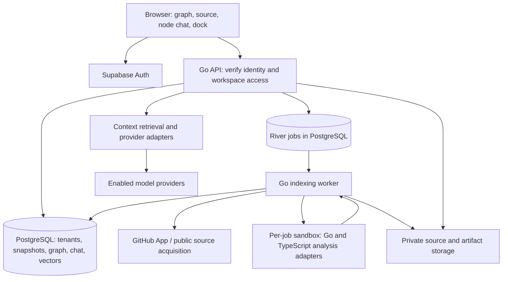

# CodeTree build plan

Status: accepted architecture target. A first local implementation is available; see [implementation status](IMPLEMENTATION.md) and [setup instructions](../README.md) for delivered features and remaining beta work.

Prepared: 25 October 2026.

## 1. Product and initial scope

CodeTree is a web app for understanding a GitHub repository through an interactive code graph. The main workflow is: sign in, connect a repository, choose a branch, explore its structure and relationships, select a symbol or source block, and ask questions grounded in that code.

The graph is the primary workspace. Conversations belong to a node or selected code context, and remain available when the user returns to that location. Users should not have to reconstruct their understanding from a single growing chat transcript.

Planning assumptions, pending the owner's language and repository preferences:

- Desktop-first responsive web app, with an accessible text outline and a 2D graph alternative.
- TypeScript/JavaScript and Go receive symbol-level analysis first. Other text files remain visible as files and searchable source, with their analysis coverage stated explicitly.
- The beta supports public and private GitHub repositories. The first technical milestone uses public repositories; private access is completed before beta.
- Every new user gets a personal workspace. Team invitations and shared workspaces can follow later.
- CodeTree supplies the model credentials. User-supplied provider keys, billing subscriptions, code editing, and automated code execution are later work.
- Google, GitHub, Apple, and email/password authentication are beta requirements. External provider registrations are operational prerequisites.

## 2. Main technical decisions

1. Use Go for the API, authorization, indexing orchestration, chat orchestration, and background workers.
2. Use a React/TypeScript SPA for the graph workspace. Vite is sufficient for this primarily authenticated application; a separate server-rendering framework is not required initially.
3. Derive graph structure from deterministic static analysis. The LLM explains source and relationships, and never becomes the authority for stored call edges.
4. Use language-specific semantic adapters. Go tools analyze Go; a small isolated TypeScript adapter analyzes JavaScript/TypeScript. The backend remains Go while analysis uses the right compiler tools.
5. Start with one PostgreSQL database for application data, graph adjacency, search, vectors, and durable jobs. Keep source artifacts in private object storage.
6. Build a modular application with separate API and worker processes from the same repository. Indexing has different resource and trust requirements from serving interactive requests.
7. Bind every graph and conversation to an immutable commit snapshot. Branch names are moving pointers, not source identities.

Go is a good fit for concurrent network work, bounded parallel analysis, streaming, and deployment. End-to-end performance will also depend on repository size, semantic analysis, graph layout, database access, and model latency. Language choice alone cannot solve those bottlenecks.

## 3. Recommended stack and dependencies

Pin stable, compatible dependency versions when implementation starts; avoid building the first release around beta compiler APIs.

| Layer | Choice | Purpose |
| --- | --- | --- |
| Web app | React, TypeScript, Vite, React Router | Workspace, navigation, build tooling |
| Styling and UI | Tailwind CSS, Radix primitives, CSS | App shell, accessible dialogs/menus, floating dock |
| Server data | TanStack Query | Fetching, cache invalidation, indexing status |
| Interaction state | Zustand | Selection, camera, panel, and dock state |
| Graph rendering | react-force-graph-3d, react-force-graph-2d, Three.js | 3D graph and alternate 2D view |
| Source display | Shiki and a line-addressable source viewer | Read-only source and cited ranges |
| API | Go net/http with chi | Routing, middleware, request cancellation |
| Database access | pgx and sqlc | Connection pooling and typed SQL |
| Migrations | goose | Versioned database schema |
| Auth | Managed Supabase Auth | Google/GitHub/Apple and email/password |
| Persistence | Supabase PostgreSQL with pgvector | Tenant data, graph, lexical and semantic retrieval |
| Background jobs | River on PostgreSQL | Durable imports, retries, cancellation, deduplication |
| Source artifacts | Private Supabase Storage through supported S3 operations | Source blobs and index artifacts |
| Structural parsing | Official Go Tree-sitter bindings and pinned grammars | Syntax extraction and language expansion |
| Go semantics | go/parser, go/ast, go/types, x/tools/go/packages | Declarations, types, symbol resolution |
| JS/TS semantics | Isolated Node/TypeScript compiler adapter | Imports, references, calls, aliases, types |
| Telemetry | slog and OpenTelemetry | Redacted logs, tracing, metrics |
| Verification | Go tests, frontend unit tests where useful, Playwright | Analysis, isolation, and critical user journeys |
| Packaging | Docker, local Compose, GitHub Actions | Reproducible development and CI |

Use a maintained JWT/JWKS verification library and provider SDKs behind small interfaces. Select those with the first supported providers rather than introducing a general agent framework in advance.

Tree-sitter introduces native C/runtime dependencies; package and test the analyzer container accordingly. A full code editor such as Monaco can be added if editing becomes a product requirement.

References: [Vite](https://vite.dev/guide/), [React Force Graph](https://github.com/vasturiano/react-force-graph), [TanStack Query](https://tanstack.com/query/latest/docs/framework/react/overview), [Radix accessibility](https://www.radix-ui.com/primitives/docs/overview/accessibility), [Shiki](https://shiki.style/guide/), [chi](https://github.com/go-chi/chi), [pgx](https://github.com/jackc/pgx), [sqlc](https://docs.sqlc.dev/en/latest/), [goose](https://github.com/pressly/goose), [River](https://riverqueue.com/docs/transactional-enqueueing), [pgvector](https://github.com/pgvector/pgvector), [Supabase S3 compatibility](https://supabase.com/docs/guides/storage/s3/compatibility), [OpenTelemetry Go](https://opentelemetry.io/docs/languages/go/).

## 4. Architecture



The API owns authorization and validated application operations. The worker owns long imports and publishes complete snapshots. Both use tenant-aware domain services. The queue's internal scheduling role is separate from application data access; worker domain transactions still establish and enforce workspace context.

Serve the SPA and `/api` under one site through a reverse proxy. Configure streaming timeouts and buffering deliberately. Use normal HTTP APIs and fetch-based SSE streams for chat; indexing status can start with bounded polling and gain SSE later. Fetch streaming supports Authorization headers without putting access tokens into URLs.

Initial production topology: static frontend, Go API container, Go worker coordinator, a sandboxed analyzer runner, managed database/auth/storage, and a managed secret store. Each analysis job gets its own isolated environment with only that snapshot mounted, a sanitized environment, no inherited database/GitHub/provider credentials, and no access to other jobs' source. Deny analyzer network egress; obtain any approved dependency metadata through a controlled acquisition step. Keep services in a compatible region and use a direct PostgreSQL connection for River's runtime features. Validate connection pooling against River's deployment guidance.

Scale API and worker replicas independently when measurements justify it. Add a separate graph database, Redis, or more services only when specific workloads require them.

## 5. User interface

### Main workspace

- Graph occupies most of the screen, with depth, restrained lighting, colorful semantic nodes, and directional relationships.
- A slim top area holds repository identity, symbol search, breadcrumbs, and indexing status.
- The bottom floating dock contains model selection, branch selection, graph controls, settings, and profile. Keep profile scope minimal until further requirements arrive.
- Clicking a node focuses it, highlights relevant incoming/outgoing edges, and opens a right inspector with Overview, Source, and Ask views.
- Asking about a source block creates a context anchored to that file and source range. A small group of pinned nodes can serve as additional context.
- Returning to a node restores its conversation. Compact summaries and pinned explanations can sit beside the relevant node.
- The graph remains stable as chat streams; camera/layout state does not reset on each token.

### Navigating large repositories

Begin with repository/package/module clusters and detected entry points. Expand into files and symbols, then bounded one- or two-hop neighborhoods. Every indexed symbol remains searchable even when it is outside the visible graph.

Offer relationship filters, expand/collapse, reset view, breadcrumbs, and caller/callee navigation. Show labels primarily for selected and nearby nodes. Persist stable positions where useful and move expensive layout work away from the main thread.

Code can contain recursion, cyclic imports, disconnected components, and multiple entry points. Use a cycle-safe graph layout. A hierarchical mode must condense cycles before using a DAG layout; the renderer's DAG mode is not suitable for an arbitrary call graph. [React Force Graph controls](https://github.com/vasturiano/react-force-graph)

Provide a 2D view, keyboard-accessible symbol outline, reduced-motion behavior, and readable DOM source/chat panels. The canvas is one navigation surface, not the sole route to product functionality.

### Semantic palette

There is no universal color standard for code entities. Define a stable CodeTree mapping using the established Okabe–Ito palette, with shared tokens in the UI and documentation.

| Entity | Color | Additional cue |
| --- | --- | --- |
| Function/method | Blue `#0072B2` | Function/method icon and label |
| Class/struct/object declaration | Orange `#E69F00` | Object/type shape |
| Interface/type alias | Purple `#CC79A7` | Type icon |
| File/package/module | Sky blue `#56B4E9` | Folder/file shape |
| Significant constant/global data | Green `#009E73` | Data icon |
| External dependency | Vermilion `#D55E00` | External badge |
| Entry point | Yellow `#F0E442` accent | Root halo/badge preserving entity color |

Use outlines and contrasting labels suitable for the active background. Entry status and selection are overlays rather than replacements for entity meaning. Solid/dashed styles and text labels distinguish resolved, possible, and inferred relationships. [Okabe–Ito guidance](https://jfly.uni-koeln.de/color/index.html), [W3C use of color](https://www.w3.org/WAI/WCAG22/Understanding/use-of-color.html).

## 6. Authentication and tenant isolation

Use Supabase Auth for passwords, OAuth, verification, password reset, and session refresh. Go validates the signed access token using the project's JWKS and checks issuer, audience, expiry, and allowed algorithm. Identity linking must use the auth provider's verified flows. [Supabase social login](https://supabase.com/docs/guides/auth/social-sign-in), [password auth](https://supabase.com/docs/guides/auth/passwords), [signing keys](https://supabase.com/docs/guides/auth/signing-keys).

Create a personal workspace transactionally or through an idempotent first-login operation. Use membership records rather than making every ownership relationship depend directly on the user ID.

Tenant-owned records carry `workspace_id`. Authorization covers repository access, snapshots, graph queries, source ranges, conversations, retrieval, object paths, cache keys, events, background jobs, and usage. Composite foreign keys keep relationships within their workspace and snapshot.

Use explicit tenant-scoped SQL plus PostgreSQL RLS. Direct pgx connections do not automatically inherit Supabase's JWT context. Runtime data access uses a non-owner role without BYPASSRLS and sets verified user/workspace context locally inside each transaction; absent context denies access. Never leave tenant context on a pooled session. Migration and narrowly scoped operational roles remain separate. [PostgreSQL RLS behavior](https://www.postgresql.org/docs/current/ddl-rowsecurity.html), [permissions with direct connections](https://supabase.com/docs/guides/ai/rag-with-permissions).

Each API request verifies membership server-side. A supplied workspace, node, or conversation ID is never proof of authorization. Integration tests exercise two users and two workspaces across all resource types.

Apple web login requires provider configuration and secret renewal operations. Add expiry tracking and rotation; the Supabase Apple OAuth guidance describes six-month secret renewal. [Apple setup](https://supabase.com/docs/guides/auth/social-sign-in/auth-apple).

## 7. GitHub access and ingestion

GitHub sign-in establishes CodeTree identity. Repository connection is a separate permission flow, available regardless of the user's login provider.

For private repositories, use a GitHub App with selected-repository, read-only access and short-lived installation tokens. Validate the user's own repository authorization; an organization installation must not expose all its repositories to every CodeTree account. Recheck access and process installation/repository revocation events. [GitHub App versus OAuth app](https://docs.github.com/en/apps/oauth-apps/building-oauth-apps/differences-between-github-apps-and-oauth-apps), [installation authentication](https://docs.github.com/en/apps/creating-github-apps/authenticating-with-a-github-app/authenticating-as-a-github-app-installation).

Import pipeline:

1. Parse and normalize the submitted GitHub URL; accept supported GitHub hosts and repository paths, not arbitrary fetch destinations.
2. Check repository access, repository limits, and available workspace quota.
3. Resolve the selected branch to a commit SHA. Create or reuse a snapshot/job using the complete analysis identity.
4. Acquire that commit's source in an isolated worker. Keep credentials out of process arguments, logs, and persisted clone configuration.
5. Inventory language/file coverage; omit binaries, dependency/vendor directories, generated assets, and configured exclusions from symbol analysis.
6. Extract syntax, declarations, imports, and source spans.
7. Resolve cross-file symbols and relationships with the appropriate language adapter.
8. Detect roots, produce graph clusters, and build lexical retrieval data. Embeddings can run as a separate stage.
9. Publish the graph snapshot atomically. Show graph readiness and semantic-search readiness separately if necessary.
10. Report coverage, skipped files, unresolved relationships, and actionable failures.

Use durable job stages, bounded concurrency, idempotent writes, deduplication, progress, retry backoff, and cancellation. A retry must not create duplicate graph entities or charge repeated summarization work.

Treat imported repositories as untrusted data. Never execute repository programs, package scripts, generators, tests, or executable compiler plugins. Do not invoke arbitrary repository build commands. Bound CPU, memory, disk, file count, and duration; constrain dependency resolution and network access. Handle symlinks and archive paths safely. Disable recursive submodules and LFS materialization initially. Missing dependencies produce partial analysis with explicit coverage information.

Prefer controlled Git source acquisition for the initial importer. If using GitHub's recursive tree API, handle its truncation flag and documented limits rather than indexing only the returned prefix. [Git clone options](https://git-scm.com/docs/git-clone.html), [GitHub trees API](https://docs.github.com/en/rest/git/trees).

Verify webhook signatures and deduplicate delivery IDs. On push, update branch pointers and enqueue work for the new SHA. Public repositories without an installation use explicit refresh initially.

## 8. Code analysis and graph contract

### Two layers of analysis

Tree-sitter provides an incremental syntax tree and structural extraction; it does not by itself establish all cross-file call targets. [Tree-sitter](https://tree-sitter.github.io/tree-sitter/), [Go bindings](https://github.com/tree-sitter/go-tree-sitter).

Use Go's AST/type/package tooling and a TypeScript compiler adapter for language semantics. Start with declarations, imports, symbol references, and statically resolvable calls. Extend with framework-specific root detection and more conservative call analysis when there is test coverage. [Go packages](https://pkg.go.dev/golang.org/x/tools/go/packages), [TypeScript Compiler API](https://github.com/microsoft/TypeScript-wiki/blob/main/Using-the-Compiler-API.md).

Semantic loading is not necessarily passive parsing: go/packages can invoke go list and compile dependency export metadata. Permit trusted compiler metadata generation only inside the per-job sandbox, with a pinned local toolchain, automatic toolchain download disabled, cgo disabled by default, and sanitized PATH/environment/build flags. Use controlled dependencies and fall back to partial syntax/type analysis when a safe complete load is unavailable. This compiles metadata without executing repository application code. [Official go/packages implementation](https://raw.githubusercontent.com/golang/tools/master/go/packages/golist.go).

The adapter accepts a read-only source snapshot and controlled configuration and returns the shared graph format. Compiler APIs evolve, so version the adapter contract and pin the actual implementation used for a snapshot.

### Graph entities

Nodes: repository root, package/module, file, function, method, class/struct, interface/type, and significant declared objects/constants. Ordinary local values and temporary object instances are not expanded by default. Source blocks can be chat anchors without becoming permanent graph nodes.

Edges: `contains`, `imports`, `calls`, `references`, `extends`, and `implements`. Direction is explicit: caller to callee, importer to imported module, parent to child. Avoid displaying containment as though it were execution flow.

Each node carries its kind, language, display name, qualified name, source file/range, snapshot ID, and parent. Each edge carries its type, source/target, source evidence, analyzer version, and resolution class. Unresolved targets stay visible as unresolved references rather than guessed links.

### Roots and limits

Offer multiple roots: application main, CLI commands, framework routes, workers, tests, or library exports. Some roots are inferred from framework conventions and must be labeled accordingly.

Static analysis cannot prove every runtime path involving reflection, dynamic dispatch, dependency injection, generated code, or dynamic imports. A library may have exported entry points rather than a main function. Display resolved, possible, and heuristic edges distinctly and publish language coverage. [Go callgraph semantics](https://pkg.go.dev/golang.org/x/tools/go/callgraph).

### Snapshot and incremental indexing

Snapshot identity includes workspace, repository, commit SHA, analyzer version, analysis configuration, and relevant build configuration. Every source link and answer is grounded in that identity.

Cache extraction by file/blob content plus analyzer configuration. Reuse unchanged files while re-resolving dependent files/packages when imports, exports, or type/configuration inputs change. File-level reuse alone is insufficient for semantic correctness.

Maintain optional logical symbol keys across commits, but make rename/move matching best effort. A branch switch loads its own snapshot and node histories. Older conversations remain attached to their original snapshot and are never silently presented as current-source answers.

## 9. Node and block conversations

A conversation subject is a node, source block, or small selected group within a single snapshot. Its identity includes workspace, repository, snapshot, and anchor. Keep separate histories per subject, with multiple threads available when needed.

For each question:

1. Verify access and resolve the active model and subject snapshot.
2. Gather the exact declaration or selected block, enclosing context, directly related types, and relevant callers/callees.
3. Retrieve useful tests, documentation, and additional code using identifier/path search and, when enabled, vector search.
4. Rank and trim context within the model's input/output budget; reserve space for the answer.
5. Send a structured context bundle through the chosen provider adapter and stream the answer.
6. Validate citation targets against supplied source ranges, and render clickable file/line references at the immutable commit.
7. Persist messages, context provenance, model identity, usage, and completion state.

Use graph/lexical retrieval first; add pgvector where it improves question coverage. All retrieval is workspace/repository/snapshot scoped before source is assembled. Avoid sending the entire repository on every question or pre-generating explanations for every node.

Repository content is evidence, not system instructions. The first release's model has no repository execution tools or credential access. The UI clearly indicates when relevant context is missing or an explanation is uncertain.

The embedding model is an indexing configuration independent of the chat selector. Changing chat models does not rebuild the graph or embeddings. Changing embedding models/dimensions requires a versioned embedding collection and controlled migration.

## 10. Developer administration and models

Provide a protected `/admin` interface with server-enforced platform roles, MFA, and an audit trail. Workspace ownership does not imply platform administration. Do not trust user-editable profile metadata for administrator status.

Admin capabilities:

- Configure a provider using an existing adapter and an approved endpoint.
- Enter/rotate provider credentials through write-only fields backed by the production secret manager.
- Add a model's provider ID, display name, context/output limits, supported capabilities, availability, and optional entitlement rules.
- Test connectivity before enabling the model.
- Enable/disable models, select defaults, and review failures, latency, and usage.
- Configure workspace request/token budgets and ingestion limits.

Store credential references and metadata in PostgreSQL. API responses never return provider secrets. Validate custom endpoints and restrict egress so a configured endpoint cannot become an internal-network fetch mechanism.

The model dock consumes only enabled model metadata and internal model IDs. The Go backend resolves credentials and enforces capabilities and budgets. Adding another model through an existing provider protocol can be configuration-only; adding a genuinely different provider protocol requires an adapter deployment.

Adapters normalize request/stream handling, cancellation, token accounting, context limits, timeouts, and error categories. Every response records the selected model. Handle retired models or provider errors visibly; do not silently send private code to a different provider.

Reserve usage budget atomically before a paid request and reconcile actual usage afterward. Repeated client submissions use idempotency keys. Interrupted streams retain their partial/failed state and do not look like completed answers.

## 11. Initial data model and API surface

| Domain | Main tables |
| --- | --- |
| Identity and ownership | profiles, workspaces, workspace_members, platform_roles |
| GitHub access | github_connections, github_installations, repository_access |
| Repositories | repositories, branches, snapshots, source_files, source_artifacts |
| Analysis | nodes, edges, analysis_runs, analysis_diagnostics |
| Retrieval | code_chunks, embedding_collections, embeddings |
| Conversations | conversations, conversation_anchors, messages, message_citations, chat_runs |
| Models and operations | providers, provider_credentials, models, model_entitlements, usage_events, audit_events |
| Queue | River-managed tables; payloads reference workspace and analysis/run IDs |

Global provider/model definitions are platform data. Tenant-owned resources have workspace-scoped keys, indexes, and access policies. Edges have indexes for both incoming and outgoing adjacency within a snapshot. Conversations and citations use immutable source identities.

Representative endpoints, subject to the actual OpenAPI contract:

- `GET /v1/workspaces` and workspace membership checks.
- `POST /v1/workspaces/{workspace}/repositories` to import a repository.
- `GET /v1/repositories/{repo}/branches` and explicit refresh/index operations.
- `GET /v1/snapshots/{snapshot}/overview`, `/nodes`, `/edges`, `/search`, and bounded neighborhoods.
- `GET /v1/snapshots/{snapshot}/files/{file}` with bounded source ranges.
- Conversation creation, history, message streaming, and cancellation.
- `GET /v1/models` for enabled model metadata.
- `/v1/admin/providers` and `/v1/admin/models` for protected configuration.
- Signed GitHub webhook receiver and durable indexing status endpoints.

Use pagination, neighborhood budgets, source-size bounds, structured errors, request IDs, and idempotency for mutations. Generate frontend API types from the API contract to reduce drift.

## 12. Delivery sequence

| Phase | Deliverable | Exit condition |
| --- | --- | --- |
| 0: feasibility slice | One public TS/JS repo, static graph, source inspector, one node question | A real repository demonstrates trustworthy relationships, readable exploration, and cited explanation |
| 1: foundation | Monorepo layout, local services, migrations, auth, personal workspaces, shell/dock | All required sign-in flows are configured and cross-user access is denied |
| 2: ingestion | GitHub App, public/private imports, durable jobs, snapshots, branch handling, Go adapter | Imports recover from failures; private access and revocation work; branches cannot mix snapshots |
| 3: graph workspace | Expandable 3D and 2D views, search, filters, semantic palette, source/block selection | Users can navigate from overview to exact code and back using mouse or keyboard |
| 4: AI and administration | Scoped context retrieval, persistent node/block chat, provider adapters, model admin, budgets | Admin adds an existing-provider model; it appears in the dock; answers cite the correct snapshot |
| 5: beta hardening | Incremental updates, coverage reporting, performance work, deletion/retention, monitoring | Accuracy, isolation, recovery, accessibility, and representative-load gates pass |

Some graph/analysis/chat work overlaps after the feasibility slice. An initial planning allowance is roughly 8–12 weeks for one experienced full-stack developer to reach a constrained beta, assuming provider credentials and registrations are available. This is an estimate to revisit after Phase 0, not a delivery commitment. Broader language support and very large repositories materially expand the work.

## 13. Verification and operational acceptance

- Analysis fixtures cover imports, methods, aliases, recursion, cycles, overloaded/dynamic cases, missing dependencies, multiple roots, and unsupported syntax. Measure declaration/reference/call resolution separately; require all asserted fixture relationships to be correct and uncertain ones to remain labeled.
- End-to-end: sign in, connect a private repository, import, search, expand a node, inspect source, ask, follow a citation, revisit another node's separate history, switch branch/model, refresh, and sign out.
- Two-workspace tests reject access through guessed repository/node/chat IDs, vector search, source objects, streams, cache entries, and background jobs.
- Security-relevant ingestion cases include malformed URLs, unsafe archive paths/symlinks, large files, timeouts, malicious configs, revocation, and duplicate webhooks.
- Test chat context selection and citations using recorded provider fixtures; evaluate a small set of real repository questions for grounded usefulness. Successful API delivery alone does not establish explanation quality.
- Benchmark representative repositories and synthetic graphs at several visible sizes, such as 250, 1,000, and 5,000 nodes, on agreed hardware. Set the shipped visible-node budget from measurements. Provisional interaction targets: p95 selection feedback below 150 ms and smooth navigation around 45–60 FPS within the chosen budget.
- Record import phase duration, queue depth, worker resource use, graph payload sizes, model first-token/total latency, token usage, errors, and database load. Model latency depends on the selected provider and should not be promised as a fixed app guarantee.
- Use private encrypted storage, short-lived authorized source access, redacted logs, documented retention, user-triggered repository/account deletion, and restore-tested database backups. Secret-file exclusions reduce accidental disclosure but cannot guarantee a repository contains no secrets.
- Support cancellation, worker restart, retry, provider outage, and database recovery without publishing partial graphs as complete snapshots.

## 14. Proposed repository layout

```text
apps/web/                 React workspace and developer admin
cmd/api/                  Go HTTP server
cmd/worker/               Go job worker
internal/auth/            Identity verification
internal/tenancy/         Workspace authorization and scoped transactions
internal/github/          Connections, repository acquisition, webhooks
internal/indexing/        Import stages and snapshot publication
internal/analysis/        Shared graph contract and Go/Tree-sitter adapters
internal/graph/           Queries, neighborhoods, coverage
internal/chat/            Context assembly, conversations, streaming
internal/models/          Registry, adapters, usage enforcement
internal/storage/         Source artifacts and retention
internal/db/              sqlc queries/generated access
services/typescript/      Isolated semantic analysis adapter
db/migrations/            Application schema
api/                      API contract
tests/fixtures/           Small known-answer repositories
deploy/                   Container and local development definitions
docs/                     Plan, graph contract, coverage, operational notes
```

Start implementation with the feasibility slice. Its result determines the initial graph rendering budget, semantic coverage, and indexing limits before committing to the broader beta scope.
